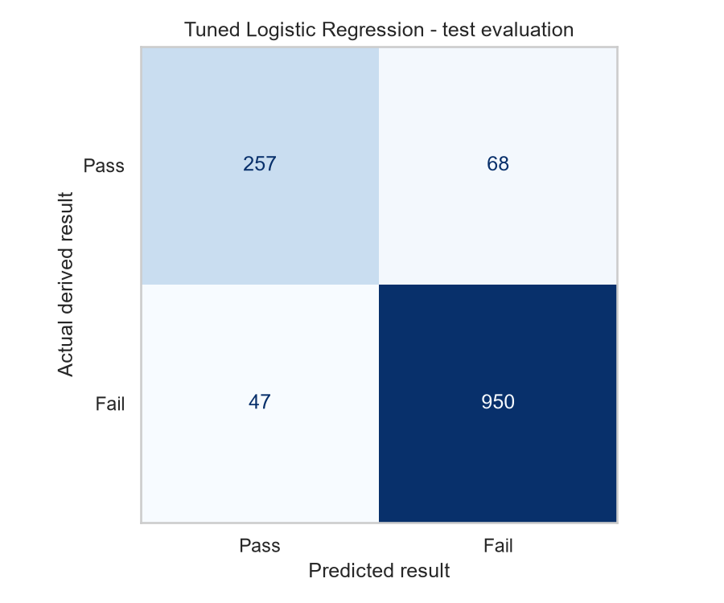
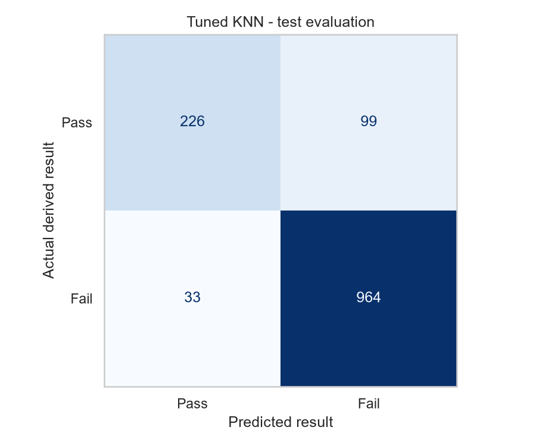
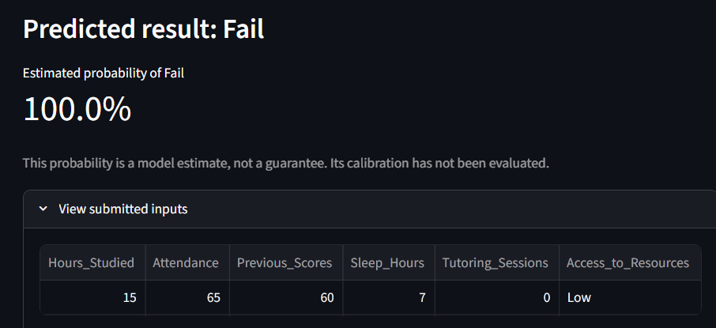
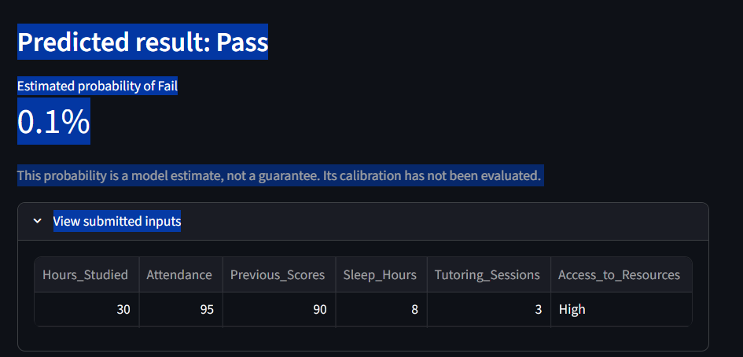

# Student Performance Prediction — Project Report

**Author:** Rari Raj Chittayil  
**Assessment:** Verveox AI/ML Trainee Program

## 1. Objective

The objective was to build a binary classification demonstration
that predicts a student's derived final result as Pass or Fail.

Logistic Regression and K-Nearest Neighbors (KNN) were compared.
The selected model was integrated into a Streamlit prediction
interface.

The application is an educational demonstration, not a system
for making real decisions about students.

## 2. Dataset and target definition

The project uses the Student Performance Factors dataset published
by lainguyn123 on Kaggle:

https://www.kaggle.com/datasets/lainguyn123/student-performance-factors

The downloaded dataset contains 6,607 rows and 20 columns.
Its representativeness of real school populations has not been
independently verified.

The dataset contains Exam_Score, rather than the binary target
required by the assignment. I derived labels using an assumed
pass threshold of 70:

- Pass = 0: Exam_Score >= 70
- Fail = 1: Exam_Score < 70

Fail is treated as the positive class.

The threshold is a demonstration assumption, not a verified school
policy. Exam_Score was excluded from the model inputs because it
directly determines the target.

## 3. Selected features

| Feature | Reason for inclusion |
|---|---|
| Hours_Studied | Represents weekly study time |
| Attendance | Represents participation in classes |
| Previous_Scores | Provides an indicator of previous academic performance |
| Sleep_Hours | Represents reported daily sleep duration |
| Tutoring_Sessions | Represents additional academic support |
| Access_to_Resources | Represents access to learning resources |

Tutoring_Sessions and Access_to_Resources were included as two
additional inputs alongside the available features corresponding
to the assignment's suggested inputs. Both already existed in
the Kaggle dataset.

Assignment marks were unavailable and were omitted rather than
replaced with invented values. Study hours were kept in their
original weekly unit.

## 4. Data quality and preprocessing

No exact duplicate rows were found.

Missing values occurred in Teacher_Quality,
Parental_Education_Level, and Distance_from_Home. These columns
were not selected as inputs. The six selected inputs contained
no missing values, so imputation was unnecessary.

One row had an Exam_Score of 101. It was excluded under the
documented assumption that scores must be between 0 and 100.
The resulting modelling dataset contained 6,606 rows.

Input ranges and resource categories were checked. Unusual but
plausible feature values were retained rather than automatically
removed as outliers.

Numeric inputs were transformed using StandardScaler.
Access_to_Resources was transformed using OneHotEncoder.

A ColumnTransformer applied the appropriate transformation to
each group of columns. A Pipeline combined these transformations
with the classifier, ensuring that preprocessing was learned
from training data only.

## 5. Exploratory data analysis

EDA on the training data included:

- Pass/Fail class distribution.
- Numeric feature distributions.
- Study hours and other numeric features grouped by result.
- Pass/Fail proportions by access to resources.
- A correlation heatmap and feature-versus-score scatter plots.

### Main observations

Students labelled Pass generally reported more weekly study
hours. The approximate median was 24 hours for Pass students
compared with 19 hours for Fail students.

Attendance was also higher among students labelled Pass:
approximately 92% median attendance compared with 76% for
students labelled Fail.

The proportion labelled Pass increased across resource-access
categories, from approximately 15% for Low to 34% for High.
However, the score distributions overlapped.

These observations describe associations. They do not establish
that changing one feature would cause a student's result to change.

The target was imbalanced, with approximately 75.4% Fail and
24.6% Pass labels.

The notebook contains the plots and their individual interpretations.

## 6. Training and validation workflow

An 80% training and 20% testing split was created using
random_state=42 and stratification.

- Training set: 5,284 rows.
- Test set: 1,322 rows.

The training set was used to learn model parameters and compare
configurations. The test set was excluded from fitting and
hyperparameter searches.

Five-fold stratified cross-validation was performed within the
training set. Each fold used a separate portion for validation,
while the remaining portions were used for fitting.

Scaling and encoding were fitted inside each cross-validation
training fold through the pipelines. This prevented information
from validation rows from influencing fitted preprocessing.

A majority-class DummyClassifier was included to check whether
the models improved upon always predicting the most common class.

### How the classifiers work

Logistic Regression learns a weighted combination of the input
features and converts it into an estimated class probability.
It provides a simple baseline for learning relationships between
the inputs and a binary outcome.

KNN compares a new input with nearby training examples and uses
their labels to predict its class. It provides a baseline capable
of representing more local, nonlinear patterns.

Scaling is particularly important for KNN because its neighbour
selection depends on distances. Without scaling, features with
larger numeric ranges could dominate those distances. Scaling
also helps Logistic Regression's optimisation and regularisation.

### Hyperparameter tuning

GridSearchCV compared configurations using training
cross-validation macro F1.

| Model | Best parameters | Best CV macro F1 |
|---|---|---:|
| Logistic Regression | C=10.0 | 0.8685 |
| KNN | n_neighbors=21, weights="distance" | 0.8413 |

Macro F1 gives equal importance to the F1 scores of Pass and Fail,
making it useful for this imbalanced dataset.

Logistic Regression was selected using these training-side
results. The selected configurations were automatically refitted
on the full training set before test prediction.

### Evaluation history

Baseline test results were inspected during an earlier development
iteration, before the training-only tuning experiment. The final
notebook was organised into training, tuning, and testing.

The reused test set remained excluded from fitting and tuning,
but it was not a never-before-inspected evaluation set. Independent
external validation would provide stronger evidence of generalisation.

## 7. Test evaluation

Fail (1) is the positive class for the binary metrics below.

| Model | Accuracy | Precision (Fail) | Recall (Fail) | F1 (Fail) | Macro F1 |
|---|---:|---:|---:|---:|---:|
| Logistic Regression | 0.9130 | 0.9332 | 0.9529 | 0.9429 | 0.8800 |
| KNN | 0.9002 | 0.9069 | 0.9669 | 0.9359 | 0.8549 |

Accuracy measures overall correctness. Fail precision measures
how often a Fail prediction is correct. Fail recall measures
how many actual Fail labels are identified. F1 balances precision
and recall.

### Confusion matrices

Rows represent actual derived results; columns represent predictions.

| Outcome | Logistic Regression | KNN |
|---|---:|---:|
| Actual Pass, predicted Pass — TN | 257 | 226 |
| Actual Pass, predicted Fail — FP | 68 | 99 |
| Actual Fail, predicted Pass — FN | 47 | 33 |
| Actual Fail, predicted Fail — TP | 950 | 964 |

A false positive is a false support alert: a student labelled
Pass is predicted to fail.

A false negative is a missed warning: a student labelled Fail
is predicted to pass and might not be flagged for support.

These derived labels do not establish whether a student actually
needs academic support.

### Model choice

I retained Logistic Regression, which had the higher training
cross-validation macro F1.

Its test results also showed higher Fail precision, Fail F1,
and macro F1. It made 115 errors compared with KNN's 132.

KNN identified 14 more Fail cases but incorrectly flagged 31 more
Pass cases. Its higher Fail recall could be useful if avoiding
missed warnings were the overriding priority and staff could
review the additional false alarms.

### Why accuracy alone is insufficient

The test set contains 997 Fail and 325 Pass labels.

Always predicting Fail would achieve approximately 75.4% accuracy,
despite identifying no Pass students. Class-specific metrics,
macro F1, and confusion matrices are therefore necessary to
understand performance across both classes.

## 8. Prediction interface

A Streamlit application accepts all six required inputs.

It loads the saved fitted pipeline from:

`models/student_performance_pipeline.joblib`

Feature names and label information are loaded from:

`models/model_metadata.json`

The application performs prediction without retraining. Numeric
bounds, whole-number tutoring counts, a category dropdown, and
a combined study/sleep-hours check provide input validation.

The predicted class and estimated Fail probability are displayed.
The interface explains that probabilities are model estimates,
not guarantees, and that calibration has not been evaluated.

### Sample tests

| Sample | Hours | Attendance | Previous score | Sleep | Tutoring | Resources | Prediction | Displayed Fail probability |
|---|---:|---:|---:|---:|---:|---|---|---:|
| 1 | 15 | 65 | 60 | 7 | 0 | Low | Fail | 100.0% |
| 2 | 30 | 95 | 90 | 8 | 3 | High | Pass | 0.1% |

The actual outcomes are unknown. These examples demonstrate
successful interface operation, not prediction correctness.
Displayed probabilities are rounded to one decimal place.

Additional testing details are recorded in `interface_testing.md`.

## 9. Limitations and future improvements

The labels depend on an assumed threshold rather than verified
school Pass/Fail decisions.

The evaluation uses a single dataset, with no independent external
validation. Therefore, the reported performance does not establish
how well the model would work in another school or population.

Class imbalance, prior inspection of the test set, and uncalibrated
probabilities also limit interpretation.

Future improvements include:

- Evaluating on independently collected data with verified outcomes.
- Assessing probability calibration using training-side validation.
- Examining performance across different student populations.
- Agreeing appropriate support-review criteria with educators.

Predictions should support human review and should never be the
sole basis for educational decisions.

## 10. AI assistance and personal contribution

ChatGPT assisted with planning, code drafts, concept explanations,
troubleshooting, and documentation.

I used this assistance to assemble and run the project locally,
review the generated outputs, and test the prediction interface.
The project includes AI-assisted code and is not claimed to have
been written entirely without assistance.

I am responsible for reviewing the submission and being able to
explain its implementation and limitations.

## 11. References

- Dataset:
  https://www.kaggle.com/datasets/lainguyn123/student-performance-factors
- Scikit-learn documentation:
  https://scikit-learn.org/stable/
- Streamlit documentation:
  https://docs.streamlit.io/